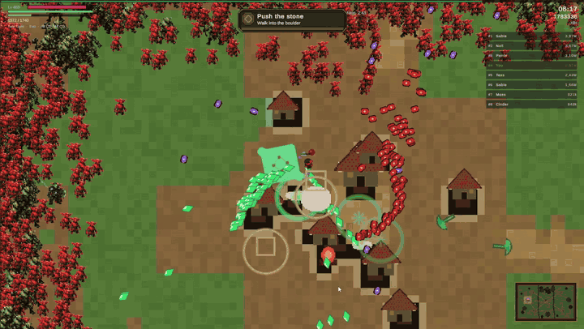
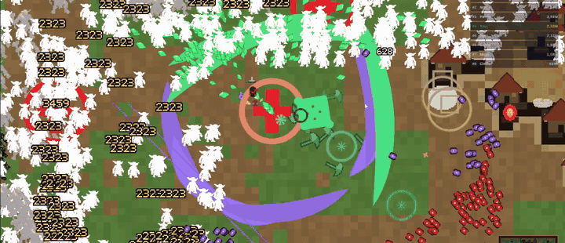

# Goblin Horde (portfolio)

**Survivor-style Unity game.** Move a hero through a goblin village, draft a build, and hold out until the boss at 10:00.

> This is a **portfolio showcase**, not the full game. The production Unity project stays private while I prepare a Steam release. Sample scripts below show how key systems are built. They will not compile as a standalone project.

**Status:** In development · PC (landscape) · Unity 6 · Planned Steam release  
**Designer / builder:** [Joseph Abraham](https://github.com/thejoebear) · YouTube: [@thebearjoe5304](https://www.youtube.com/@thebearjoe5304)

---

## Pitch

Goblin Horde is a single-player survivor run set inside a living village, not an empty arena. You pick a hero, draft weapons and upgrades as you level, and the horde pathfinds around forests, water, and buildings instead of walking through them. Survive to 10:00, then face one of three climax bosses.

Between runs, a full meta layer keeps the loop sticky: gear with case openings, Goblin Slots, and per-hero talent trees. Under the hood, a deep scoring and leaderboard system gives solo runs a competitive multiplayer feel against real players on Steam.

---

## What I designed and built

Solo project: systems design, content design, Unity implementation, and UI.

| Area | What shipped |
| --- | --- |
| Core loop | 10-minute timed run, auto-firing weapons, dash, XP gems, level-up draft, chest drafts, end-of-run gold |
| Scoring / rivalry | Kill-bucket scoring with hit penalties, live HUD rank, 30-point score curves, Steam KeepBest board with real players; ranked score locks at boss clear so endless play stays for fun |
| Gear / items | Nine worn slots (helm through ring), Common to Legendary rarity, rolled multi-stat pieces, stash and loadout per hero |
| Case openings | Paid case tiers that reel to the won piece, with epic/legendary holds before the stash line |
| Goblin Slots | Meta slot machine: 5 reels, 3 rows, 20 lines, wilds, charms, free spins; Den / Warcamp / Warchief stakes |
| Talent trees | Three trees per hero (offense, mobility, survival or signature) with gated layouts, climax nodes, and unique hooks |
| Heroes | 21 heroes with health/stat blocks, starting weapons, bag/stash sizes, traits, and signatures (Warden free; others unlock via feats or gold) |
| Draft / buildcraft | Card picks on level-up and chests; weapon fusion into Supers; inventory and stash pressure |
| Combat space | Off-screen spawns into the village; melee swarm, camped ranged, brutes/elites; early-run move-speed ramp so new players are not wiped in the first minute |
| Objectives | Optional map objectives that pay a boon if completed |
| Meta | Roster, armory, shrine upgrades, quartermaster relics, gear shop, cases, and slots |
| Climax | At 10:00: Goblin Warlord, Goblin Captain, or Hex Warchief; win and leave, or keep fighting unranked |

---

## Design pillars

1. **The village is the arena.** Terrain blocks and shapes pathing, so positioning matters more than pure DPS.
2. **Draft tension, not just power.** Every level-up is a choice; chests are bigger bets; fusions reward committing to a build.
3. **Readable pressure curve.** Half-speed then 70% speed early; health scales so a finished build still has something to chew on.
4. **Hero fantasy first.** Signatures, traits, and named talent trees make each run feel like a different character, not a reskin.
5. **Compete without co-op.** Deep scoring and live rank against real players make a solo run feel like multiplayer rivalry.
6. **Meta that earns its screen time.** Gear cases, slots, and talent trees give long-term goals without replacing the run.

---

## Scoring and competitive feel

Solo runs are ranked against real players, not just survived.

- **Kill buckets:** grunts, reds, specialists, elites, and champions bank points at phase rates as they die.
- **Hit debt:** every accepted hit shaves a slice of your live total (projectile hits and contact bumps use different fractions), so reckless play costs rank.
- **Live HUD rank:** your place on the board updates during the run so you feel other players mid-fight, not only on a recap screen.
- **Score curves:** every 20 seconds the game stores your real score (30 checkpoints across the 10-minute run). Those curves power fair comparisons against other players' actual runs.
- **Steam board:** personal-best KeepBest uploads from real players; ranked score locks when the boss dies so post-clear endless mode does not overwrite a fair result.

That depth is what gives Goblin Horde a competitive multiplayer feel inside a single-player survivor loop.

---

## Gear, cases, slots, and talent trees

These systems live in the current local build (ahead of the private GitHub mirror).

### Gear and items
Nine worn slots from helm to ring. Pieces roll rarity from Common to Legendary with multiple stat lines (health, armor, damage, crit, area, gold find, and more). Stash and worn loadouts are saved per hero so loadout choices stick between runs.

### Case openings
Paid case tiers open with a full presentation: the chest drops, a reel eases to the won piece, and epic or legendary wins hold the screen before the stash line. The roll and price come from the gear catalog, not a fake animation.

### Goblin Slots
A meta slot machine with five reels, three rows, and twenty lines. Wilds, charms, and free spins sit on Den, Warcamp, and Warchief stakes. The whole round, including free spins, is resolved when the stake is paid so outcomes stay fair and save-clean.

### Talent trees
Each hero gets three named trees (roles like Offense, Mobility, Survival, or Signature). Layout templates (Spear, Fork, Wide, Diamond, Ladder, Asymmetric) control row/col gates, max ranks, and sparse requires links. Climax and unique nodes give each hero a distinct path, not a shared generic grid.

---

## Sample scripts

These are **excerpts from the production project**, chosen to show design systems without shipping the full game, assets, or data dumps.

| File | Why it's here |
| --- | --- |
| [`samples/DraftMath.cs`](samples/DraftMath.cs) | How draft offers are weighted and filtered |
| [`samples/XPManager.cs`](samples/XPManager.cs) | XP, leveling, and the pause-into-draft handoff |
| [`samples/WeaponBase.cs`](samples/WeaponBase.cs) | Shared weapon behaviour for the auto-fire loadout |
| [`samples/KillCounter.cs`](samples/KillCounter.cs) | Small run metric used by UI and end-of-run scoring |
| [`samples/ScoreCurve.cs`](samples/ScoreCurve.cs) | Checkpoint score curves packed for Steam leaderboard rivalry |
| [`samples/GearCatalog.cs`](samples/GearCatalog.cs) | Gear slots, rarity, stats, and case roll rules |
| [`samples/TalentLayouts.cs`](samples/TalentLayouts.cs) | Named talent-tree shapes with gates and requires |

Not included on purpose: full weapon/upgrade databases, case/slot UI shells, scenes, prefabs, art, audio, and anything that would recreate a playable build.

---

## Role fit

Useful for recruiters looking for someone who can **own a game loop end-to-end**: draft/economy systems, gear and meta progression, talent trees, competitive scoring and leaderboards, hero differentiation, and shipping that design in Unity C#.

---

## Links

- YouTube shorts / gameplay: [youtube.com/@thebearjoe5304](https://www.youtube.com/@thebearjoe5304)
- Full production repo: private (Steam-bound; local build is ahead of the public mirror)
- Other public Unity work: [Celestial Solitaire](https://github.com/thejoebear/puzzlecardgame) (rename / README polish in progress)

---

*Questions about the design? Open an issue on this repo or reach me via LinkedIn / the contact on my applications.*
